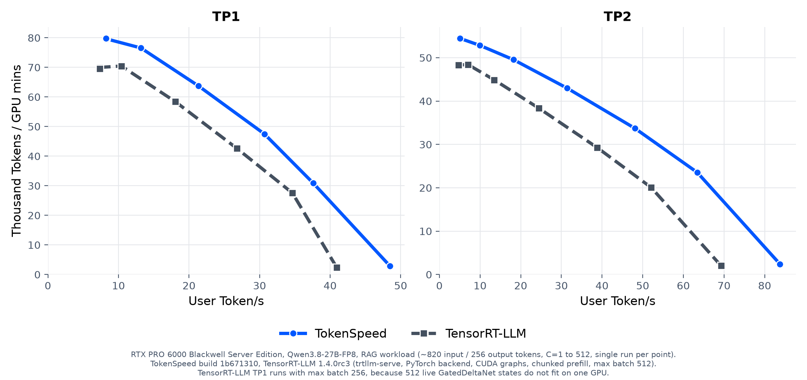
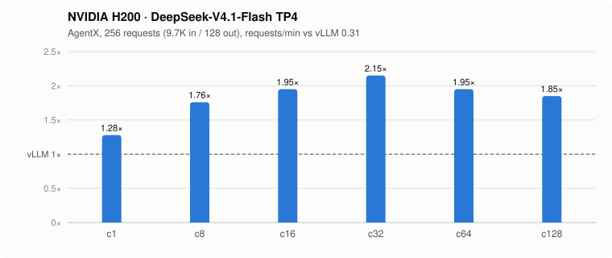
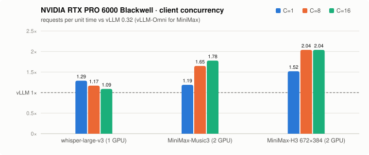
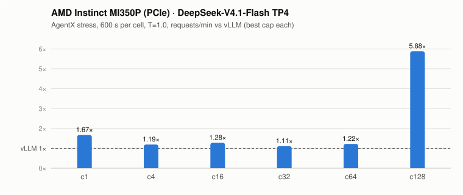

# UnieInfra

UnieInfra is UnieAI's LLM inference engine for **agentic workloads**: long multi-turn prompts with heavy prefix reuse, short outputs, and many concurrent sessions. It targets production serving on both NVIDIA and AMD GPUs, with particular attention to PCIe-only multi-GPU machines where communication dominates.

Core components:

- **Scheduler**: C++ control plane and Python execution plane. Request
  lifecycle, KV cache ownership, and overlap timing are encoded as a
  finite-state machine, with safe KV resource reuse enforced by the type system at compile time.
- **Kernels**: pluggable, layered kernel system with a portable public API and
  a centralized registry; Triton Gluon kernels for AMD gfx950 and CuteDSL kernels for NVIDIA.
- **Entrypoint**: SMG and Dynamo drive the engine from Rust over its msgpack
  wire, with no Python on the request path.

## SM120 (RTX PRO 6000 Blackwell)

TokenSpeed runs natively on SM120 (compute capability 12.0), with no SM100-only fallbacks:

- **GEMMs and indexer**: DeepGEMM SM120 kernels for FP8, MXFP4 and NVFP4 GEMMs, MQA logits, and the DeepSeek-V4.1 indexer.
- **Attention**: CuTe DSL and Triton tensor-core kernels for DSA, MLA, and DeepSeek-V4.
- **MoE**: MegaMoE across two PCIe GPUs.

`scripts/install.sh` builds DeepGEMM from the `DeepGEMM` submodule. Serve with `tokenspeed serve` as in the [Launching a Server](https://lightseek.org/tokenspeed/guides/launching) guide.

On Qwen3.8-27B-FP8 (RAG workload, C=1 to 512), TokenSpeed reaches 1.09x to 1.20x the output tokens/s of TensorRT-LLM 1.4.0rc3 at every concurrency, on both TP1 and TP2 (single run per point; TensorRT-LLM TP1 ran with max batch 256 because 512 recurrent states do not fit on one GPU). DeepSeek-V4.1-Flash, Qwen3.8-27B-NVFP4 and Qwen3.5-122B-A10B-NVFP4 also serve on SM120.

Details: [DeepGEMM report](https://github.com/nctu6/DeepGEMM/blob/nctu6/deepgemm_report.md) and [benchmarks](https://github.com/nctu6/DeepGEMM/blob/nctu6/deepgemm_benchmark.md).

<p align="center">
  
</p>

<p align="center">
  <em>TokenSpeed vs. TensorRT-LLM on RTX PRO 6000 Blackwell (SM120), Qwen3.8-27B-FP8, TP1 and TP2</em>
</p>

## Design

- **One scheduling path, one execution path.** Prefill/decode disaggregation, speculation, CUDA/HIP graphs and compute/communication overlap are parameters of the same path, never a second path.
- **The control plane owns state.** Per-request state (KV pages, compressed attention state, sliding windows) lives in the LCM cache arena managed by the C++ scheduler, so it is allocated, prefix-matched, retracted and freed together.
- **Kernels are a first-class subsystem**, separated from the engine by a public API, a registry with explicit selection, and a plugin mechanism for heterogeneous accelerators.

The deliberate invariants of each subsystem are written down in [`docs/design/`](docs/design/).

## Results

### NVIDIA H200 — DeepSeek-V4.1-Flash, TP4

<picture>
  <source media="(prefers-color-scheme: dark)" srcset="assets/perf/h200-dsv41-dark.svg">
  
</picture>

AgentX agent workload, 256 requests (9.7K input tokens on average, 128 output tokens each), prefix cache flushed before every cell, each engine run three times in a different cell order (median). Baseline: vLLM 0.31.0. Speedup in requests/min:

| Concurrency | c1 | c8 | c16 | c32 | c64 | c128 |
|---|---|---|---|---|---|---|
| UnieInfra vs vLLM 0.31 | 1.28× | 1.76× | 1.95× | 2.15× | 1.95× | 1.85× |

- At c16, output throughput is 1,354 vs 693 tok/s and TPOT 9.1 vs 18.7 ms; total throughput counting input tokens is about 103.7K vs 53.0K tok/s.
- At c1, decode is at parity (TPOT 2.6 vs 2.7 ms); the lead comes from TTFT (84 vs 186 ms).
- GSM8K (1,319 problems, greedy): 0.9356.
- Main levers: prefill-graph coverage and batching for V4.1 attention, kernel-selection memoization, no serving-time recompiles, and `--prefill-coalesce-ms` (hold new prefills briefly while others decode).

### NVIDIA RTX PRO 6000 Blackwell (sm120)

<picture>
  <source media="(prefers-color-scheme: dark)" srcset="assets/perf/pro6000-models-dark.svg">
  
</picture>

Baseline: vLLM 0.32.0 (with vLLM-Omni for MiniMax models).

| Model | Setup | Result |
|---|---|---|
| whisper-large-v3 | 1 GPU, C = 1 / 8 / 16 | requests/s 1.29× / 1.17× / 1.09×, lower streamed TTFT, same WER |
| MiniMax-Music3 | 2 GPUs (PCIe), C = 1 / 8 / 16 | requests/min 1.19× / 1.65× / 1.78× |
| MiniMax-H3 (text-to-video+audio) | 2 GPUs (PCIe), 672×384, C = 1 / 8 / 16 | requests/min 1.52× / 2.04× / 2.04× |
| gemma-3-27B / gemma-4-31B | TP1 / TP2, C = 512, 1K in / 1K out | +6.1% / +2.2% tok/s |
| DeepSeek-V4.1-Flash | TP4, text and image | served on 96 GiB cards (Engram tables in host memory) |

### AMD Instinct MI350P (gfx950, PCIe-only) — DeepSeek-V4.1-Flash, TP4

<picture>
  <source media="(prefers-color-scheme: dark)" srcset="assets/perf/mi350p-dsv41-dark.svg">
  
</picture>

4× MI350P without xGMI, AgentX coding-agent traces in stress mode (600 s per cell, T=1.0 sampling, no quantized communication), each engine at its best running-request cap. Speedup in requests/min:

| Concurrency | c1 | c4 | c16 | c32 | c64 | c128 |
|---|---|---|---|---|---|---|
| UnieInfra vs vLLM | 1.67× | 1.19× | 1.28× | 1.11× | 1.22× | 5.88× |

What makes the difference on this machine:

- **Attention-structured KV cache**: about 940 B/token versus about 2,090 B/token, which keeps 93–94% prefix hit rate at c128.
- **DSpark speculative decoding** with coupled drafting and lossless block verification, including a shard-local variant for TP.
- **Prefill two-micro-batch overlap**: the all-reduce of one half runs while the other half computes (requires a high-priority communication stream on ROCm).
- **gfx950 kernels sized for 128 CUs / 4 XCDs**: indexer, selected attention, block32 MXFP8 GEMM, prefill MXFP4 MoE, and Iris all-reduce over PCIe.
- **Three-tier KV cache (GPU → Host RAM → local NVMe)**: prefixes evicted from HBM go to pinned Host memory (L2) and to segment files on local disk (L3, CRC-checked, written with O_DIRECT, survives restarts). DeepSeek-V4.1 KV is identical on every attention-TP rank, so the four ranks keep one shared L3 copy (4× less disk), and L3 restores keep two read batches in flight. For a 24K-token prompt, TTFT is 0.82 s recomputed, 0.05 s from Host RAM and 0.08 s from disk after a restart.

All behaviour-changing features are opt-in environment flags; see the hardware bring-up skill in [`.skills/unieinfra-hw-optimize`](.skills/unieinfra-hw-optimize/SKILL.md) for the measurement method, flags and pitfalls.

## Documentation

- [Docs Index](docs/index.md)
- [Getting Started](docs/guides/getting-started.md)
- [Launching a Server](docs/guides/launching.md)
- [Supported Models](docs/models/supported.md)
- [Model Recipes](docs/recipes/models.md)
- [Server Parameters](docs/configuration/server.md)
- [Compatible Parameters](docs/configuration/compatible-parameters.md)
- [Parallelism](docs/serving/parallelism.md)
- [Design documents](docs/design/)

## Contributing

See [CONTRIBUTING.md](CONTRIBUTING.md) and the agent guidelines in [AGENTS.md](AGENTS.md).

## Acknowledgments

UnieInfra is a fork of [TokenSpeed](https://github.com/lightseekorg/tokenspeed), the speed-of-light LLM inference engine for agentic workloads developed by the TokenSpeed team at the non-profit [LightSeek Foundation](https://lightseek.org/), and is distributed under the same [MIT License](LICENSE). The scheduler, kernel system and entrypoint architecture described above come from TokenSpeed, and the Python packages and directories (`tokenspeed`, `tokenspeed-kernel`, `tokenspeed-kernel-amd`, `tokenspeed-scheduler`, …) keep their upstream names. We thank the TokenSpeed team and the projects listed in [ACKNOWLEDGEMENTS.md](ACKNOWLEDGEMENTS.md).

If you use the TokenSpeed architecture in your work, please cite:

```bibtex
@misc{tokenspeed2026,
  author       = {{TokenSpeed Team}},
  title        = {{TokenSpeed}: A Speed-of-Light {LLM} Inference Engine},
  year         = {2026},
  howpublished = {\url{https://github.com/lightseekorg/tokenspeed}}
}
```
